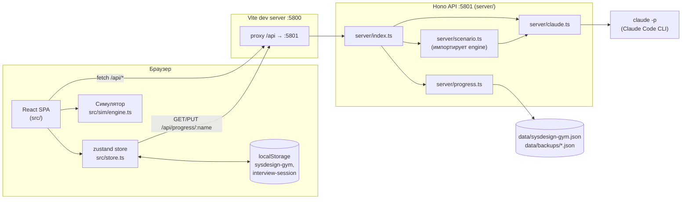
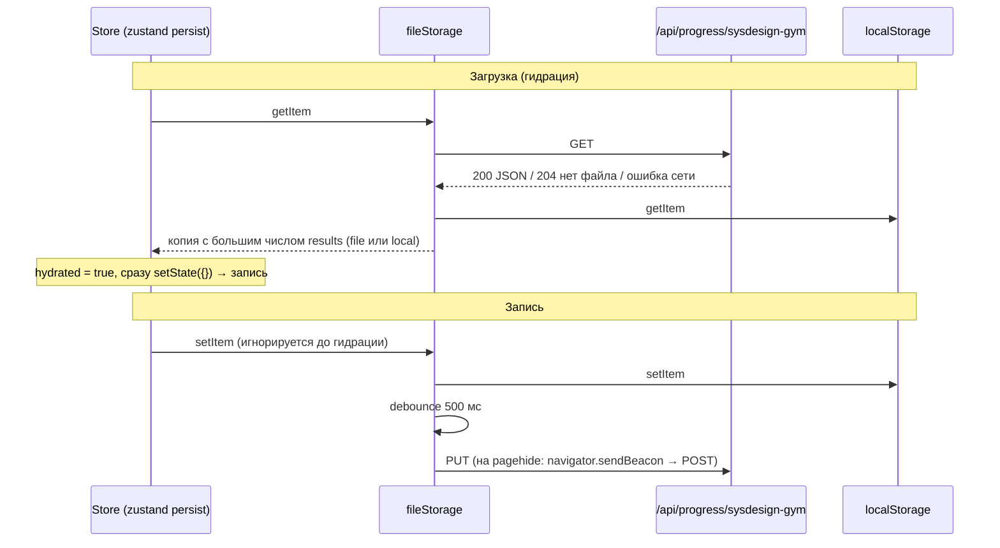

# 02. Архитектура

## Общая схема



## Процессы и порты

`pnpm dev` через `concurrently` запускает два процесса:

| Процесс | Команда | Порт | Переменная |
|---|---|---|---|
| `web` | `vite` | 5800 (`strictPort`) | `WEB_PORT` |
| `api` | `node --watch --import tsx server/index.ts` | 5801 | `API_PORT` |

Vite проксирует всё, что начинается на `/api`, на `http://localhost:${API_PORT}` (`vite.config.ts`). Поэтому фронтенд всегда ходит по относительному пути `/api/...` и не знает порта API.

`scripts/dev.command` (двойной клик в Finder на macOS) ищет первую свободную пару соседних портов из `5800/5801 … 5808/5809`, экспортирует `WEB_PORT`/`API_PORT`, через 4 секунды открывает браузер и запускает `pnpm dev`.

API при `SIGTERM`/`SIGINT` сразу закрывает порт: `node --watch` перезапускает процесс сигналом, и новому процессу нужен свободный порт.

## Где живёт логика

Почти вся логика выполняется **в браузере**:

- симулятор дежурств (`src/sim/engine.ts`) тикает в клиенте через `useSimulation` (1 тик = 1 минута сценария, скорость ×1/×2/×4 = 1000/500/250 мс);
- игра Blue Team (`src/defense/engine.ts`) детерминирована сидом и тоже клиентская;
- мгновенная проверка задач L1–L3, квизов и дуэлей происходит в браузере;
- XP, кредиты, квесты, достижения вычисляются на клиенте (`src/store.ts`, `src/game/watcher.ts`).

Сервер нужен только для двух вещей: **вызовов ИИ** и **сохранения прогресса в файл**. Есть одно пересечение: `server/scenario.ts` импортирует клиентский движок `src/sim/engine.ts`, чтобы проверить сгенерированный ИИ сценарий на проходимость.

## Хранение прогресса

Прогресс хранится в zustand-сторе `useProgress` (`src/store.ts`) под ключом `sysdesign-gym`, версия схемы `1`.



Ключевые решения:

- **Выбор копии при загрузке:** если есть и файл, и localStorage, берётся та, где больше записей в `state.results`. Новый профиль браузера не затрёт файл, а пустой файл не затрёт браузер.
- **Запись только после гидрации:** пустое начальное состояние никогда не перезаписывает файл.
- **Сервер защищает файл** (`server/progress.ts`): тело должно быть валидным JSON, запись атомарная (`.tmp` + `rename`), раз в день пишется бэкап `data/backups/<name>-YYYY-MM-DD.json`, хранятся последние 14. Имя файла санитизируется (`[^a-z0-9_-]` → `_`).
- **Миграция v0 → v1:** баланс кредитов делится на 3 (пересчёт экономики) с записью в журнал.
- `toasts` не сохраняются (`partialize`).
- Сессия mock-интервью хранится отдельно, в localStorage под ключом `interview-session`.

Если API не запущен, приложение работает на localStorage, но ИИ-функции падают с понятной ошибкой «AI-сервер не отвечает (HTTP …). Запущен ли pnpm dev:api?» (`src/lib/api.ts`).

## Клиентские модули

```
src/
├── main.tsx            вход: запускает game watcher после гидрации стора, рендерит App
├── App.tsx             роутер, верхнее меню, TaskPage
├── store.ts            прогресс, экономика, XP, серия (streak)
├── company.ts          подключение приватного пакета компании (import.meta.glob)
├── lib/
│   ├── api.ts          postApi (JSON) и streamApi (текстовый поток с NUL-ошибкой)
│   └── blocks.ts       метаданные блоков холста, звания (ranks)
├── tasks/              56 задач + типы; index.ts собирает и сортирует по уровню
├── components/         представления задач (InstantViews, BottleneckView, DesignView),
│                       Markdown + плагины (seq-диаграммы, таймлайны, перки, термины-глоссарий),
│                       AskBox (стриминг ответа наставника), ModuleNav, TaskShell
├── sim/                движок, сценарии, игровой цикл, холст, дашборд, инспектор, knobs
├── learn/              уроки, путь обучения, прогресс модулей
├── wiki/               справочник, карточки, сравнения, реализации, квиз, визуалы
├── duels/              дуэли backend/frontend/LLM/security
├── practice/           элементы тренировки дня, «объясни сам», аспекты
├── defense/            Blue Team: каталог, уровни, движок, тесты
├── interview/          задачи mock-интервью и режимы
├── game/               определения достижений/квестов/магазина, watcher, Toaster
└── pages/              страницы-маршруты
```

## Серверные модули

```
server/
├── index.ts      маршруты Hono, генерик-обёртка route(), стриминг /api/ask/stream
├── claude.ts     runClaude (JSON) и streamClaude (stream-json) поверх `claude -p`
├── progress.ts   файловое хранилище прогресса с бэкапами
├── grade.ts      оценка дизайна по рубрике (+ JSON-схема)
├── explain.ts    проверка «объясни сам»
├── ask.ts        наставник в справочнике
├── postmortem.ts ИИ-постмортем дежурства
├── scenario.ts   генерация сценария + плейтест движком
├── interview.ts  реплики интервьюера и итоговый разбор
└── ctf.ts        CTF: уровни защиты, пароли (только на сервере), ИИ-судья
```

## Приватный пакет компании

`src/company.ts` подключает необязательный пакет через `import.meta.glob('./company/*.ts', { eager: true })` и берёт экспорт `companyPack` из первого найденного файла:

```ts
interface CompanyPack {
  name: string
  about: string        // абзац о компании над сценариями
  sandbox: SimGraph    // архитектура для /sandbox/company
  scenarios: Scenario[]
}
```

Папка `src/company/` в `.gitignore`. Если её нет, раздел «Моя компания» просто не появляется. Это способ потренироваться на реальной архитектуре своей компании, не публикуя её.

## Деплой на GitHub Pages

`.github/workflows/pages.yml` на push в `main`:

1. `pnpm install --frozen-lockfile` и `pnpm build` с `BASE_PATH=/<имя-репозитория>/`;
2. копирует `dist/index.html` в `dist/404.html` (SPA-фолбэк для глубоких ссылок);
3. публикует `dist` в Pages.

`vite.config.ts` берёт `base` из `BASE_PATH`, а роутер получает `basename` из `import.meta.env.BASE_URL`.

**Ограничение:** на Pages нет API-сервера. Всё клиентское (задачи L1–L3, уроки, справочник, дуэли, дежурства, Blue Team) работает, прогресс живёт только в localStorage. Всё ИИ (проверка дизайна, наставник, интервью, CTF, постмортем, генерация сценариев) не работает. Подробнее в [08-findings.md](08-findings.md).
